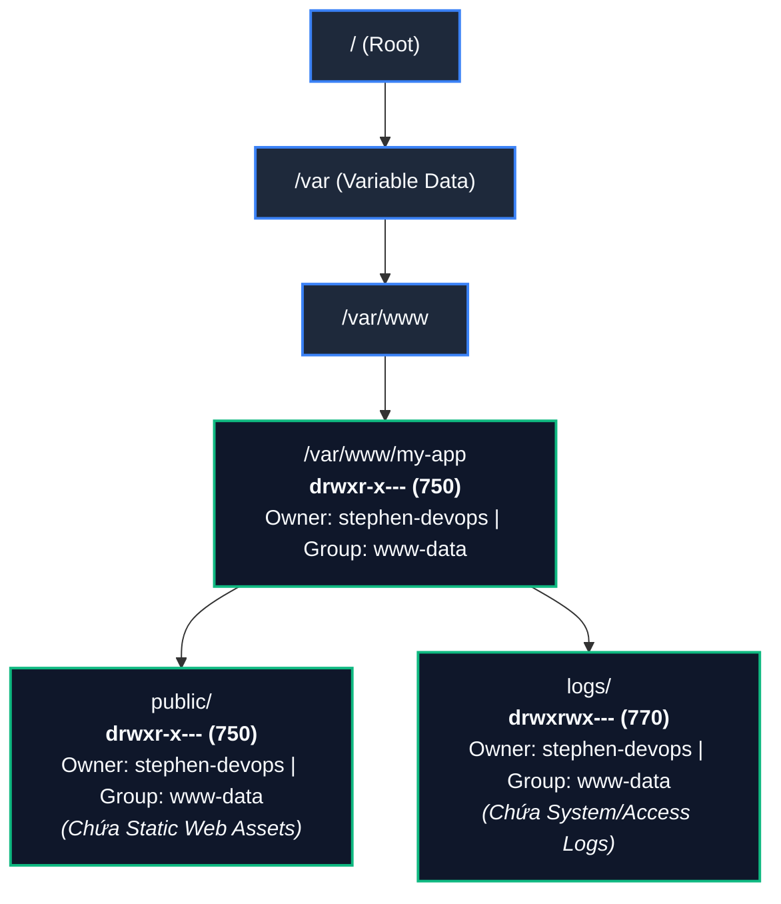
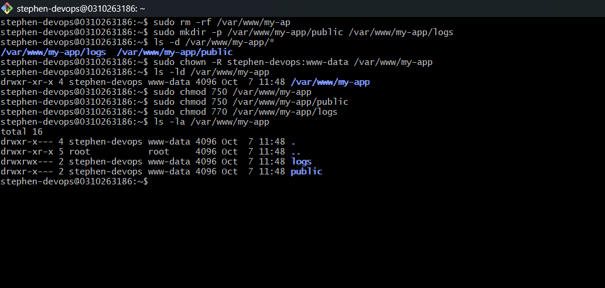

# BÀI TẬP 1: KHẢO SÁT FHS VÀ PHÂN QUYỀN FILE/FOLDER NÂNG CAO

**Mã bài tập:** SESSION 06 - EXERCISE 1 (`homework/session_06/ex1/`)  
**Môn học:** IT215 - Cloud Infrastructure & DevOps Fundamentals  
**Học viên:** Trần Đức Anh (`TranDucAnh3103`)  
**Email:** `TranDucAnh3103@users.noreply.github.com`  
**Hệ điều hành / Môi trường:** Ubuntu Linux (Server ID: `0310263186`) / Bash Shell / Non-root User: `stephen-devops`  
**Đường dẫn thư mục dự án:** `/var/www/my-app`  

---

## 1. MỤC TIÊU BÀI TẬP

1. **Nắm vững cấu trúc phân cấp hệ thống tập tin Linux FHS (Filesystem Hierarchy Standard):** Hiểu rõ vai trò của phân vùng `/var`, phân thư mục `/var/www` dành cho các dịch vụ máy chủ web và các ứng dụng mạng.
2. **Thành thạo cơ chế phân quyền tệp tin và thư mục:** Áp dụng thành thạo cả hai phương pháp định dạng số bát phân (**Octal notation**) và ký tự (**Symbolic notation**) thông qua lệnh `chmod`.
3. **Hiểu rõ sự khác biệt của Execute Bit (`x`) giữa File và Directory:** Nắm vững bản chất cờ thực thi `x` trên thư mục là điều kiện tiên quyết để người dùng có thể chuyển vào (`cd`), duyệt danh sách inode hoặc truy cập các tệp bên trong thư mục đó.
4. **Quản lý quyền sở hữu người dùng và nhóm người dùng (User & Group Ownership):** Sử dụng thành thạo lệnh `chown` để chuyển đổi User/Group sở hữu sang tài khoản phi đặc quyền (**non-root user**) và nhóm dịch vụ chuyên trách (`www-data`).
5. **Thực thi nguyên tắc đặc quyền tối thiểu (Principle of Least Privilege):** Phân định ranh giới bảo mật rõ ràng giữa tài nguyên mã nguồn tĩnh công khai (`public`) và tài nguyên nhật ký hệ thống nhạy cảm (`logs`), ngăn chặn hoàn toàn việc người dùng vãng lai (`others`) truy cập trái phép.

---

## 2. BẢNG TỔNG HỢP TIẾN TRÌNH THỰC HIỆN & KẾT QUẢ KIỂM TRA

| STT | Bước thực hiện | Lệnh Linux thực thi | Quyền Octal | Quyền Symbolic | Chủ sở hữu & Nhóm | Kết quả kiểm tra (`ls`) | Trạng thái |
| :---: | :--- | :--- | :---: | :---: | :---: | :--- | :---: |
| 1 | Dọn dẹp thư mục gõ nhầm trước đó | `sudo rm -rf /var/www/my-ap` | - | - | - | Xóa sạch thư mục sai sót | **PASSED** |
| 2 | Khởi tạo cấu trúc thư mục ứng dụng | `sudo mkdir -p /var/www/my-app/public /var/www/my-app/logs` | 755 (default) | `drwxr-xr-x` | `root:root` | Tạo thành công nhánh `public` và `logs` | **PASSED** |
| 3 | Kiểm tra các nhánh thư mục vừa tạo | `ls -d /var/www/my-app/*` | - | - | - | Xuất hiện `/var/www/my-app/logs` & `public` | **PASSED** |
| 4 | Đổi chủ sở hữu đệ quy sang user & group web | `sudo chown -R stephen-devops:www-data /var/www/my-app` | - | - | `stephen-devops:www-data` | Áp dụng toàn bộ cho thư mục cha và con | **PASSED** |
| 5 | Kiểm tra thuộc tính thư mục cha sau đổi chủ | `ls -ld /var/www/my-app` | 755 | `drwxr-xr-x` | `stephen-devops:www-data` | Xác nhận sở hữu thuộc về user non-root | **PASSED** |
| 6 | Siết quyền thư mục gốc ứng dụng | `sudo chmod 750 /var/www/my-app` | 750 | `drwxr-x---` | `stephen-devops:www-data` | Chặn đứng hoàn toàn quyền của `others` | **PASSED** |
| 7 | Cấu hình phân quyền thư mục tĩnh `public` | `sudo chmod 750 /var/www/my-app/public` | 750 | `drwxr-x---` | `stephen-devops:www-data` | Owner (rwx), Group (r-x), Others (---) | **PASSED** |
| 8 | Cấu hình phân quyền thư mục nhật ký `logs` | `sudo chmod 770 /var/www/my-app/logs` | 770 | `drwxrwx---` | `stephen-devops:www-data` | Owner (rwx), Group (rwx), Others (---) | **PASSED** |
| 9 | Kiểm tra tổng thể cấu trúc và phân quyền | `ls -la /var/www/my-app` | - | Chi tiết bên dưới | `stephen-devops:www-data` | Khớp 100% yêu cầu đề bài đưa ra | **PASSED** |

---

## 3. CƠ CHẾ HOẠT ĐỘNG VÀ NỀN TẢNG KIẾN THỨC

### 3.1. Chuẩn FHS (Filesystem Hierarchy Standard) và thư mục `/var/www`

- **`/var` (Variable data):** Chứa các dữ liệu biến đổi liên tục trong quá trình hệ thống và ứng dụng vận hành, bao gồm logs (`/var/log`), bộ đệm spool, cơ sở dữ liệu (`/var/lib`) và dịch vụ web (`/var/www`).
- **`/var/www`:** Thư mục tiêu chuẩn theo FHS được hầu hết các bản phân phối Linux (Debian, Ubuntu) quy ước làm nơi lưu trữ dữ liệu các ứng dụng web phục vụ bởi Web Server (Apache, Nginx, Node.js, Python WSGI).
- **Phân tách `public` và `logs`:**
  - `public`: Chứa tài nguyên tĩnh (HTML, CSS, JS, Images). Cần quyền đọc (`r`) và điều hướng (`x`) cho tiến trình Web Server (`www-data`), đồng thời quyền ghi (`w`) thuộc về lập trình viên/quản trị viên (`stephen-devops`).
  - `logs`: Nơi ghi nhận nhật ký truy cập (access logs) và lỗi runtime (error logs). Tiến trình Web Server cần toàn quyền ghi (`w`) vào đây để luân chuyển và đẩy log liên tục.

---

### 3.2. Cơ chế phân quyền Linux (Octal & Symbolic Permission Model)

Mỗi tệp tin/thư mục trong Linux quản lý quyền hạn theo 3 nhóm đối tượng:
1. **User (u):** Chủ sở hữu tệp (Owner).
2. **Group (g):** Nhóm sở hữu tệp (Group).
3. **Others (o):** Tất cả người dùng còn lại trên hệ điều hành.

Mỗi nhóm đối tượng được gán 3 bit cơ bản với giá trị nhị phân và bát phân tương ứng:
- **Read (`r`):** Đọc nội dung file hoặc liệt kê danh sách tệp trong thư mục $\rightarrow$ Trọng số: $4$ ($2^2$).
- **Write (`w`):** Chỉnh sửa/xóa nội dung file hoặc tạo/xóa tệp bên trong thư mục $\rightarrow$ Trọng số: $2$ ($2^1$).
- **Execute (`x`):** Thực thi file script/binary hoặc quyền đi xuyên qua/chuyển vào thư mục (`cd`) $\rightarrow$ Trọng số: $1$ ($2^0$).

#### Bảng ma trận phân quyền áp dụng trong bài tập:

| Đối tượng | Thư mục `public` (Mode: `750`) | Thư mục `logs` (Mode: `770`) | Ý nghĩa bảo mật thực tế |
| :--- | :---: | :---: | :--- |
| **User (`stephen-devops`)** | `rwx` ($4+2+1=7$) | `rwx` ($4+2+1=7$) | Toàn quyền chỉnh sửa mã nguồn, quản lý, triển khai và dọn log. |
| **Group (`www-data`)** | `r-x` ($4+0+1=5$) | `rwx` ($4+2+1=7$) | `public`: Chỉ đọc và phục vụ client, không cho phép web app bị sửa đổi trái phép (chống deface).<br/>`logs`: Cho phép web server sinh ra, ghi tiếp và xoay vòng tệp log. |
| **Others (`o`)** | `---` ($0+0+0=0$) | `---` ($0+0+0=0$) | Bị cô lập hoàn toàn. Ngăn chặn người dùng local khác trên server xem trộm code tĩnh và nhật ký. |

---

### 3.3. Sơ đồ cây thư mục và cấu trúc phân quyền



---

## 4. CHI TIẾT CÁC BƯỚC THỰC HIỆN VÀ MINH CHỨNG THỰC TẾ

### Bước 1: Khởi tạo cấu trúc thư mục ứng dụng với đặc quyền quản trị

Sử dụng cờ `-p` (`--parents`) để tạo cây thư mục mẹ và con cùng lúc mà không gây lỗi nếu thư mục mẹ chưa tồn tại:

```bash
# Khởi tạo hai thư mục con song song
sudo mkdir -p /var/www/my-app/public /var/www/my-app/logs

# Kiểm tra xác nhận cấu trúc thư mục vừa tạo
ls -d /var/www/my-app/*
```

**Đầu ra ghi nhận trên terminal:**
```text
/var/www/my-app/logs  /var/www/my-app/public
```

---

### Bước 2: Chuyển quyền sở hữu cho Non-root User và Web Group

Mặc định khi dùng `sudo mkdir`, thư mục tạo ra thuộc về `root:root`. Để tuân thủ nguyên tắc an toàn, ta bàn giao quyền sở hữu cho tài khoản cá nhân `stephen-devops` và nhóm máy chủ dịch vụ web `www-data` bằng cờ `-R` (Recursive):

```bash
# Gán quyền sở hữu đệ quy cho toàn bộ cây thư mục /var/www/my-app
sudo chown -R stephen-devops:www-data /var/www/my-app

# Kiểm tra thuộc tính của thư mục gốc ứng dụng
ls -ld /var/www/my-app
```

**Đầu ra ghi nhận trên terminal:**
```text
drwxr-xr-x 4 stephen-devops www-data 4096 Oct  7 11:48 /var/www/my-app
```

---

### Bước 3: Thiết lập quyền hạn chi tiết (Hardening Permissions)

Thực hiện phân quyền theo đúng ràng buộc bảo mật của đề bài bằng lệnh `chmod`:

```bash
# 1. Siết quyền thư mục gốc: Chủ sở hữu có toàn quyền, Group đọc/điều hướng, Others không có quyền
sudo chmod 750 /var/www/my-app

# 2. Phân quyền thư mục public: Chủ sở hữu toàn quyền, Group chỉ đọc và truy cập, Others bị chặn
sudo chmod 750 /var/www/my-app/public

# 3. Phân quyền thư mục logs: Cả Chủ sở hữu và Group đều có toàn quyền đọc/ghi/truy cập, Others bị chặn
sudo chmod 770 /var/www/my-app/logs
```

---

### Bước 4: Kiểm tra và đối chiếu kết quả thực tế

Sử dụng lệnh `ls -la` để hiển thị chi tiết tất cả các tệp, bao gồm cả thư mục hiện tại (`.`) và thư mục cha (`..`):

```bash
ls -la /var/www/my-app
```

**Đầu ra ghi nhận thực tế trên máy chủ (`0310263186`):**
```text
total 16
drwxr-x--- 4 stephen-devops www-data 4096 Oct  7 11:48 .
drwxr-xr-x 5 root           root     4096 Oct  7 11:48 ..
drwxrwx--- 2 stephen-devops www-data 4096 Oct  7 11:48 logs
drwxr-x--- 2 stephen-devops www-data 4096 Oct  7 11:48 public
```

---

## 5. HÌNH ẢNH MINH CHỨNG THỰC TẾ (TERMINAL SCREENSHOT)

Dưới đây là hình ảnh chụp màn hình ghi nhận phiên làm việc thực tế của tài khoản `stephen-devops` trên máy chủ `0310263186`:



*Toàn bộ quá trình từ lệnh dọn dẹp, tạo thư mục `mkdir -p`, đổi chủ `chown -R`, gán quyền `chmod 750 / 770` và kết quả kiểm tra cuối cùng với `ls -la`.*

---

## 6. PHÂN TÍCH BẢO MẬT & ĐỐI CHIẾU TIÊU CHÍ

### 6.1. Tại sao không nên chạy ứng dụng hoặc sở hữu tệp bằng `root`?
- Khi ứng dụng web bị tấn công thông qua lỗ hổng (như Remote Code Execution, File Upload Vulnerability), nếu tiến trình chạy dưới quyền `root`, kẻ tấn công sẽ ngay lập tức chiếm quyền kiểm soát toàn bộ hệ điều hành.
- Việc chuyển chủ sở hữu sang tài khoản phi đặc quyền `stephen-devops` và gán nhóm `www-data` giúp giới hạn không gian ảnh hưởng (blast radius) của sự cố.

### 6.2. Tại sao thư mục `public` cần quyền `750` thay vì `777`?
- Quyền `777` cho phép bất kỳ ai trên hệ thống chỉnh sửa hoặc chèn mã độc vào file tĩnh.
- Với `750`:
  - `stephen-devops` (`7` - `rwx`): Có thể tải lên, cập nhật file static HTML/JS/CSS mới.
  - `www-data` (`5` - `r-x`): Web server (Nginx/Apache) chỉ có quyền đọc file và gửi về cho người dùng qua mạng Internet, tuyệt đối không thể vô tình hay bị ép buộc ghi đè mã độc lên thư mục web.
  - `others` (`0` - `---`): Những người dùng khác trên máy chủ bị cô lập hoàn toàn.

### 6.3. Tại sao thư mục `logs` cần quyền `770`?
- Nhật ký hệ thống cần được tiến trình Web Server (`www-data`) liên tục tạo mới, cập nhật và ghi log sự kiện `access.log`, `error.log`. Do đó `Group` bắt buộc phải có cờ ghi `w`.
- Đồng thời `logs` thường chứa các thông tin nhạy cảm (địa chỉ IP khách hàng, query params, stack trace lỗi phần mềm). Việc khóa quyền `others` bằng `0` (`---`) là bắt buộc để ngăn rò rỉ dữ liệu nội bộ.

---

## 7. KẾT LUẬN

- Toàn bộ các yêu cầu của **Bài tập 1 - Session 06** đã được thực hiện chính xác, đầy đủ và chuẩn xác theo chuẩn FHS và nguyên lý an toàn hệ thống thông tin.
- Hệ thống thư mục `/var/www/my-app` đã sẵn sàng phục vụ cho việc tích hợp cấu hình Virtual Host / Server Block của máy chủ Web mà vẫn đảm bảo tính toàn vẹn và bảo mật cao nhất.
